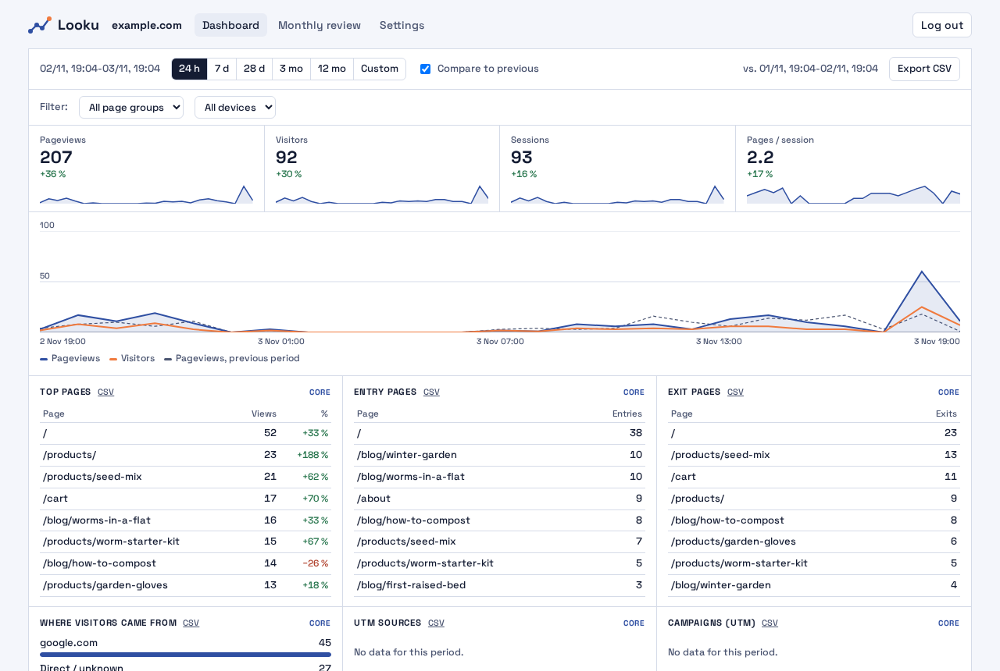

<p align="center"></p>

# Looku

Web analytics that your site's server records, stored in one SQLite file on your own machine.
No script in the browser, nothing stored on the visitor's device.

**[Live demo](https://niemenjoki.github.io/looku/demo/)** (made-up data) ·
**[Documentation](https://niemenjoki.github.io/looku/)** · [Suomeksi](https://niemenjoki.github.io/looku/fi/)

<picture>
  <source media="(prefers-color-scheme: dark)" srcset="website/public/screens/overview-en-dark.png">
  
</picture>

## Why Looku

- **Server-side first.** Your site's server sends each page view to Looku, signed. Ad blockers and script blockers
  do not change the numbers, and the page loads nothing extra.
- **Small to run.** One Docker image, one SQLite file, no external services. It fits on a home server, and the
  dashboard can stay on your home network.
- **Shop and plain-language reports included.** Orders, purchase path and best sellers next to the page views, and a
  monthly review written in sentences, also by email. Dashboard in English and Finnish.

How it compares with Plausible, Umami, GoatCounter and Matomo: [comparison](https://niemenjoki.github.io/looku/comparison/).

## What it records

- Page views for all visitors: pages, referrers, campaigns, devices, countries.
- Visitors and sessions from a hash that changes daily, or none at all (a per-site setting).
- Modules: shop, campaigns, content (reading time and scroll depth from visitors who consented).
- Read API (`/api/v1`, OpenAPI) for your own dashboards or Home Assistant.

Looku is not a cookie banner tool and does not make anything legal by itself. See [privacy and the law](https://niemenjoki.github.io/looku/privacy/).

## Documentation

**[niemenjoki.github.io/looku](https://niemenjoki.github.io/looku/)**, in English and Finnish. Step-by-step guides for beginners and a
reference for the rest:

- [Start here](https://niemenjoki.github.io/looku/start-here/): what you need and which setup suits you
- Three tutorials: [try Looku on your computer](https://niemenjoki.github.io/looku/tutorials/try-it/) in about 20 minutes, [your first installation](https://niemenjoki.github.io/looku/tutorials/home-server/) and [connect your site](https://niemenjoki.github.io/looku/tutorials/connect-your-site/)
- [What you can do with Looku](https://niemenjoki.github.io/looku/use-cases/): seven common uses and what to turn on
- Install on a [home server with Cloudflare](https://niemenjoki.github.io/looku/guides/home-server-cloudflare/) or a
  [VPS with Caddy](https://niemenjoki.github.io/looku/guides/vps-caddy/)
- [Connect a Next.js site](https://niemenjoki.github.io/looku/guides/connect-nextjs/), or [Node.js, Express, Cloudflare or your own](https://niemenjoki.github.io/looku/guides/connect-other/)
- [Privacy and the law](https://niemenjoki.github.io/looku/privacy/): what is collected, the open legal question, a privacy notice template
- [Suomeksi](https://niemenjoki.github.io/looku/fi/)

The pages are Markdown files in [`website/src/content/docs`](website/src/content/docs), so they can also be read here.

## Quick start

For readers who know Docker; the guides above explain each step.

```bash
cd deploy
cp .env.example .env
mkdir -p data && sudo chown 1000:1000 data
docker compose up -d
docker compose run --rm ingest site:add example --domain example.com
docker compose run --rm -it ingest admin:password
```

Then [connect your site](https://niemenjoki.github.io/looku/guides/connect-nextjs/) and open the dashboard (`http://127.0.0.1:8788` by default).

## Packages

| Package | What |
|---|---|
| `packages/engine` | receiver, storage, reports, read API, CLI (`looku`) |
| `packages/ui` | the dashboard: static files that use the read API |
| `packages/next` | Next.js connector, browser collector route, `sendOrder` |
| `packages/node` | Node.js http and Express connector |
| `packages/browser` | browser collector for consenting visitors |

`npm install` and `npm test` in the root run all tests (Node.js 22 or newer). The documentation site is in
`website` (`npm install` and `npm run dev` there; Node.js 22.22 or newer).

## Support

Questions and bug reports are welcome as [GitHub issues](https://github.com/niemenjoki/looku/issues). Looku is made
by one person in their spare time, so answers can take a few days. Help with installing on your own server is not
included; the [guides](https://niemenjoki.github.io/looku/) cover the supported setups.

## License

The receiver, storage, read API and dashboard (`packages/engine`, `packages/ui`) are under the GNU Affero General
Public License 3.0 ([LICENSE](LICENSE)). The connectors that you add to your site (`packages/next`, `packages/node`,
`packages/browser`) are under the MIT License (`LICENSE` in each package), so you can use them in any site, open or
closed. The dashboard font Space Grotesk is under the SIL Open Font License 1.1
(`packages/ui/public/fonts/OFL.txt`).

Made by Joonas Niemenjoki ([about](https://niemenjoki.github.io/looku/about/)).
